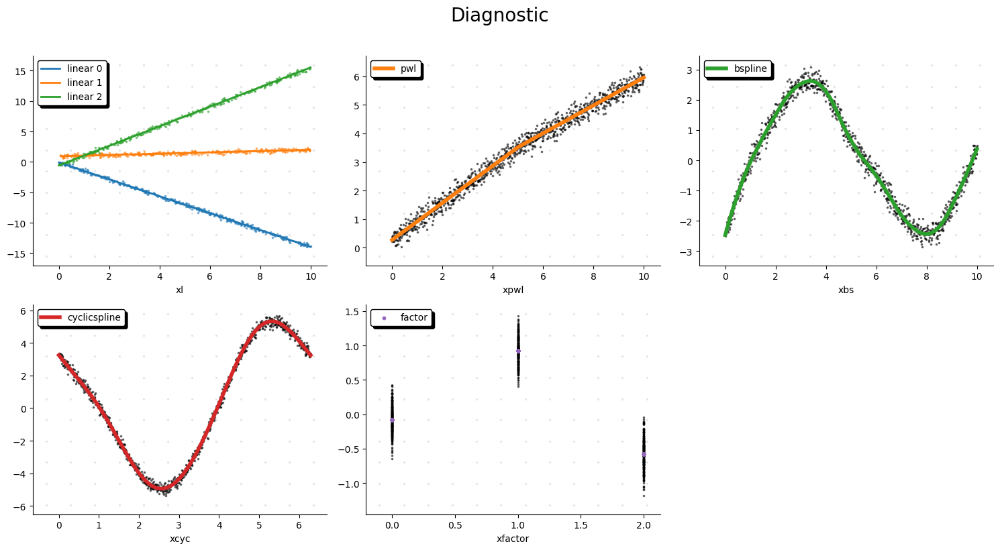

<p align="center">
  
</p>

# LPSpline


LPSpline is a Python package for building and optimizing linear spline models using an intuitive additive API. It provides a flexible way to model non-linear relationships using various spline types like Piecewise Linear, B-Splines, Cyclic Splines, and Categorical Factors.

## Documentation
Visit the [documentation](https://lpspline.readthedocs.io/en/latest/) for a complete overview and some examples with plots.


## Installation

Install `lpspline` via pip directly from the repository, or if published:

```bash
pip install lpspline
```


## Main Features

- Additive model definition
- CVXPY backend for optimization
- Multiple spline types: Linear, Piecewise Linear, B-Splines, Cyclic Splines, Categorical Factors, Constant
- Penalties on the splines: Ridge, Lasso
- Constraints as chainable methods: `increasing`, `decreasing`, `convex`, `concave`, `bounded`, `passes_through` (optionally on a window or on some `by` groups)
- Fit a spline on a subset of rows (`train_on`) and switch it off on others (`active_where`)
- Link functions: `Log`, `Exp`, `Sigmoid`
- Save and load models with a single line of code
- Polars DataFrame integration
- Nice plots using `matplotlib` and `pimpmyplot`

## Sandbox

Visit the [marimo playground](https://molab.marimo.io/notebooks/nb_MWvkutFSuuXinahopPY1NA) for a live demo

## Quick Start

Here a small code example:

```python
import numpy as np
import polars as pl
from lpspline import l, pwl, bs, cs, f
from lpspline.viz import plot_diagnostic
from lpspline.datasets import load_demo_dataset


# ---------------------------------------- Data Generation
X, y = load_demo_dataset(samples = 1000)

# ---------------------------------------- Model Definition
model = (
    +l(term='xl', by='xfactor')
    + pwl(term='xpwl', knots=3)
    + bs(term="xbs", knots=10, degree=2)
    + cs(term="xcyc", order=3)
    + f(term="xfactor")
)

# ---------------------------------------- Model Fitting
model.fit(X, y)
model.summary()

# ---------------------------------------- Model Prediction
predictions = model.predict(X)

# ---------------------------------------- Model Visualization
plot_diagnostic(model=model, X=X, y=y, ncols=3)
```

## Constraints

Constraints are chainable methods on each spline, optionally restricted to a window:

```python
from lpspline import bs, l

model = (
    bs("temperature", knots=10)
        .increasing(start=15)                 # non-decreasing for temperature >= 15
        .bounded(lower=0)                     # never negative
        .passes_through(points=[(20, 0.0)])   # equal to 0 at 20 degrees
    + l("price").decreasing()
)
```

## Training and activity subsets

```python
import polars as pl
from lpspline import cs, l

model = (
    cs("hour", order=3, period=24)
        .train_on(pl.col("day_index") < 1000)    # fit only on these rows
        .active_where(pl.col("feature3") <= 0)   # 0 elsewhere, in fit and predict
    + l("temperature")
)
```

See the [documentation](https://lpspline.readthedocs.io/en/latest/) for details and examples.

## Expected output

Once the model is fitted, `model.summary()` prints a detailed summary to the console and `plot_diagnostic` shows the fitted splines.

```
========================================================================================================================
✨ Model Summary ✨
========================================================================================================================
Problem Status: ✅ optimal
------------------------------------------------------------------------------------------------------------------------
Spline Type          | Term         | Tag             | Constraints          | Penalties            | Params
------------------------------------------------------------------------------------------------------------------------
🟢 Linear            | xl           | linear          | None                 | None                 | 6       
🟢 PiecewiseLinear   | xpwl         | pwl             | None                 | None                 | 5       
🟢 BSpline           | xbs          | bspline         | None                 | None                 | 11      
🟢 CyclicSpline      | xcyc         | cyclicspline    | None                 | None                 | 7       
🟢 Factor            | xfactor      | factor          | None                 | None                 | 3       
------------------------------------------------------------------------------------------------------------------------
📊 Total Parameters                                                                                 | 32
========================================================================================================================

Model fitted successfully.
```



