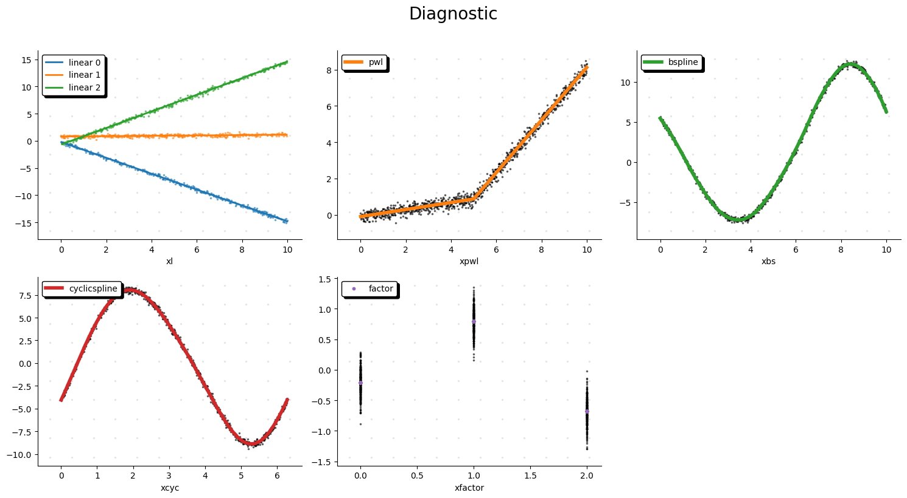
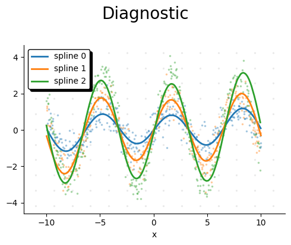
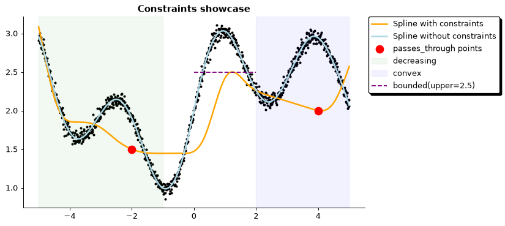
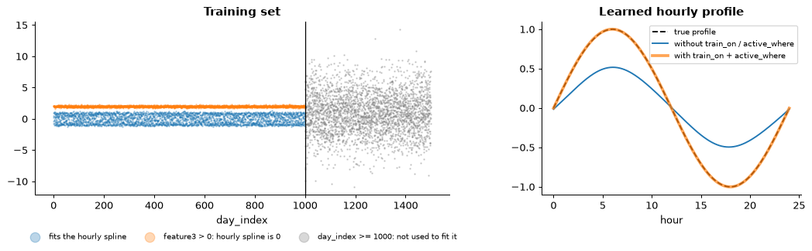
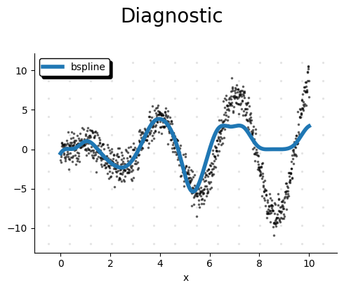

:html_theme.sidebar_primary.remove:

Demo
====

Standard regression
------------------------

.. code-block:: python

    from lpspline import l, pwl, bs, cs, f
    from lpspline.viz import plot_diagnostic
    from lpspline.datasets import load_demo_dataset

    X, y = load_demo_dataset(samples=1000)

    model = (
        +l(term='xl', by='xfactor')
        + pwl(term='xpwl', knots=3)
        + bs(term="xbs", knots=10, degree=2)
        + cs(term="xcyc", order=3)
        + f(term="xfactor")
    )

    model.fit(X, y)
    plot_diagnostic(model=model, X=X, y=y, ncols=3)

by splines
------------

.. code-block:: python

    from lpspline import bs, l, pwl, cs
    from lpspline.datasets import load_by_dataset
    from lpspline.viz import plot_diagnostic

    X, y = load_by_dataset(samples=1000, type='cyclic')

    model = (
        + cs(term='x', tag='spline', order=3, by='by')

        ## Try using these splines instead 
        #+ l(term='x', tag='spline', by='by')
        #+ pwl(term='x', tag='spline', by='by', knots=10)
        #+ bs(term='x', tag='spline', by='by', knots=10)
    )
    
    model.fit(X, y)
    plot_diagnostic(model=model, X=X, y=y, ncols=3)

Constraints
-----------

Constraints are added with chainable methods on the spline:
``increasing``, ``decreasing``, ``convex``, ``concave``, ``bounded`` and ``passes_through``.
Each accepts optional ``start``/``end`` to apply it only on part of the feature range.

.. code-block:: python

    import numpy as np
    import polars as pl
    import matplotlib.pyplot as plt
    import pimpmyplot as pmp

    from lpspline import bs

    # -------------------------- Create demo dataset with wiggly target
    np.random.seed(50)
    N = 1000
    x = np.linspace(-5, 5, N)
    y = (np.tanh(x) + 1) + np.exp(-x / 5) + np.sin(2 * x) / 2 + np.random.randn(N) * 0.05
    df = pl.DataFrame({"x": x, "y": y})

    # -------------------------- Model with constraints
    anchor_points = [(-2, 1.5), (4, 2)]
    model = (
        # Try changing the spline using pwl
        +bs("x", knots=np.linspace(-10, 10, 30), degree=3, tag="bs")
            .convex(start=2)                         # convex for x >= 2
            .decreasing(end=-1)                      # decreasing for x <= -1
            .passes_through(points=anchor_points)    # must go through these points
            .bounded(upper=2.5, start=0, end=2)      # stay below 2.5 on [0, 2]
    )

    # -------------------------- Model without constraints for comparison
    model_nocs = +bs("x", knots=np.linspace(-10, 10, 30), degree=3, tag="bs")

    model.fit(X=df, y=df["y"])
    model_nocs.fit(X=df, y=df["y"])

    # -------------------------- Plot
    plt.scatter(df["x"], df["y"], color="k", s=5)
    plt.plot(df["x"], model.predict(df), color="orange", linewidth=2, label="Spline with constraints")
    plt.plot(df["x"], model_nocs.predict(df), color="lightblue", linewidth=2, label="Spline without constraints")
    plt.scatter(*zip(*anchor_points), color="r", s=100, zorder=100, label="passes_through points")
    plt.axvspan(xmin=-5, xmax=-1, color="green", alpha=.05, label="decreasing")
    plt.axvspan(xmin=2, xmax=5, color="blue", alpha=.05, label="convex")
    plt.hlines(2.5, 0, 2, color="purple", linestyle="--", label="bounded(upper=2.5)")
    pmp.legend(loc="ext side upper right")
    pmp.remove_axis("top", "right")
    plt.title("Constraints showcase", fontweight="bold")

The model summary lists every constraint in plain words:

.. code-block:: text

   Details
   🎯 bs (1000 training rows)
        constraint:   convex for x ≥ 2
        constraint:   decreasing for x ≤ -1
        constraint:   passes through (-2, 1.5), (4, 2)
        constraint:   bounded in [-∞, 2.5] for 0 ≤ x ≤ 2

Training and activity subsets
-----------------------------

``train_on`` fits a spline on a subset of rows only; ``active_where`` makes it
return 0 outside a condition, both when fitting and when predicting.

Here an hourly profile is only reliable before day 1000 (a sensor breaks
afterwards), and it only exists when ``feature3 <= 0``; otherwise the target
is a flat level explained by a ``flag`` term.

.. code-block:: python

    import numpy as np
    import polars as pl
    from lpspline import cs, l

    rng = np.random.default_rng(0)
    n_days = 1500
    day_index = np.repeat(np.arange(n_days), 24)
    hour = np.tile(np.arange(24), n_days).astype(float)
    feature3 = rng.normal(size=day_index.size)

    profile = np.sin(2 * np.pi * hour / 24)
    y = (feature3 <= 0) * profile + (feature3 > 0) * 2.0 + rng.normal(0, 0.1, hour.size)
    y[day_index >= 1000] += rng.normal(0, 3, (day_index >= 1000).sum())  # broken sensor

    X = pl.DataFrame({"day_index": day_index, "hour": hour, "feature3": feature3})
    X = X.with_columns(flag=(pl.col("feature3") > 0).cast(pl.Float64))
    y = pl.Series("y", y)

    model = (
        cs("hour", order=3, period=24, tag="hourly")
            .train_on(pl.col("day_index") < 1000)     # learn the profile on clean data only
            .active_where(pl.col("feature3") <= 0)    # and switch it off when feature3 > 0
        + l("flag", bias=False, tag="flag")
    )
    model.fit(X, y)

    hourly = model.get_spline("hourly")
    hourly.fit_mask(X).sum()   # rows actually used to fit the hourly spline

Without the subsets the profile is flattened by the noisy period and by the
rows where it should be off; with them it matches the true profile.
See ``notebook/subset_demo.py`` for an interactive walkthrough.

Link functions
--------------

.. code-block:: python

    import numpy as np
    import polars as pl
    import matplotlib.pyplot as plt
    import pimpmyplot as pmp

    from lpspline import l
    from lpspline.link import Log, Exp

    # ----------------- Demo dataset
    N = 1000
    X = pl.DataFrame({
        'x': np.linspace(1.,10, N)
    })
    y = pl.Series(np.log(X['x']) + np.random.randn(N)*0.1)

    # ----------------- Model with log link
    model = Exp(
        +l(term='x') # This is a linear term!
    )
    model.fit(X, y, summary=False)

    # ----------------- Plot
    plt.scatter(X['x'], y, color='r', alpha=.5, s=10, label='target')
    plt.scatter(X['x'], model.predict(X), color='k', alpha=.5, s=10, label='model')
    pmp.legend()
    pmp.remove_axis('top', 'right')
    pmp.bullet_grid()
    plt.title('Link regression', fontweight='bold')

