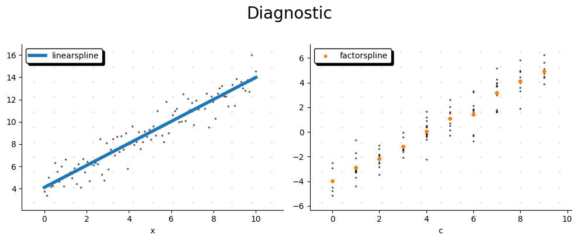

:html_theme.sidebar_secondary.remove:

Quickstart
==========

Installation
------------

Install ``lpspline`` via pip directly from the command line:

.. code-block:: bash

   pip install lpspline

Basic Usage
-----------

LPSpline optimizes shape-constrained additive configurations utilizing convex methods (via CVXPY). 
It generates regression equations binding B-Splines, Linear blocks, or Categorical matrices smoothly.

For each spline type there is a dedicated class you can import

.. code-block:: python

   from lpspline import c, f, l, pwl, bs, cs

* ``c``: constant
* ``f``: factor
* ``l``: linear
* ``pwl``: piecewise linear
* ``bs``: B-spline
* ``cs``: cyclic spline

LpRegressor
-----------

The class ``LpRegressor`` is a sklearn-like interface to perform a regression with your data.

The easiest way to initialize an instance is to simply write down the formula.

.. code-block:: python

   from lpspline import f, l

   mymodel = (
      l(term='x')
      + f(term='c')
   )

`term` is the name of the column in the DataFrame X the spline is fitted on.

.. tip::

   If your model consist in just one spline you can initialize the instance like so:

   .. code-block:: python

      mymodel = +l(term='x')

You can still initialize the ``LpRegressor`` creating an instance in the classical way:

.. code-block:: python

   mymodel = LpRegressor(splines=[l(term='x'), f(term='c')])

Every spline has a ``tag`` identifying it in the model (by default its type,
e.g. ``"linear"`` or ``"bspline"``). Tags must be unique, so give an explicit
tag when a model contains two splines of the same type:

.. code-block:: python

   mymodel = l(term='x', tag='lin_x') + l(term='z', tag='lin_z')
   mymodel.get_spline('lin_z')   # retrieve a spline by tag

Fit and predict   
----------------

``LpRegressor`` is compatible with sklearn syntax. It works with ``polars`` DataFrames and Series.

.. code-block:: python

   import polars as pl
   import numpy as np
   from lpspline import f, l

   X = pl.DataFrame({
      'x': np.linspace(0, 10, 100),
      'c': np.random.randint(0, 10, 100)
   })
   y = pl.Series(X['x'] + X['c'] + np.random.randn(100))

   mymodel = l(term='x') + f(term='c')
   mymodel.fit(X, y)
   y_pred = mymodel.predict(X)
   components = mymodel.predict(X, return_components=True)  # one column per spline

Calling ``fit`` again on new data refits from scratch: automatic knots, cyclic
periods, ``by`` groups and factor classes are recomputed from the new data.

The optimisation runs on `CVXPY <https://www.cvxpy.org>`_ with the ``CLARABEL``
solver by default. You can choose another installed solver and pass it options:

.. code-block:: python

   mymodel.fit(X, y, solver="SCS", eps=1e-6)   # extra keyword arguments go to the solver
   mymodel.fit(X, y, summary=False)            # skip the printed summary

If the solver does not reach an optimal solution, ``fit`` emits a
``RuntimeWarning`` with the solver status (e.g. ``infeasible`` when constraints
contradict each other).

Summary
-------

When you fit the model a summary is printed to the console with all main informations:

* spline type
* term
* applied constraints
* applied penalties
* number of parameters
* a *Details* section describing every constraint and row subset in plain words

For example, for ``l(term='x').increasing() + f(term='c')``:

.. code-block:: text

   ========================================================================================================================
   ✨ Model Summary ✨
   ========================================================================================================================
   Problem Status: ✅ optimal
   ------------------------------------------------------------------------------------------------------------------------
   Spline Type          | Term         | Tag             | Constraints          | Penalties            | Params
   ------------------------------------------------------------------------------------------------------------------------
   🟢 Linear            | x            | linear          | increasing           | None                 | 2
   🟢 Factor            | c            | factor          | None                 | None                 | 10
   ------------------------------------------------------------------------------------------------------------------------
   📊 Total Parameters                                                                                 | 12
   ------------------------------------------------------------------------------------------------------------------------
   Details
   🎯 linear (100 training rows)
        constraint:   increasing
   ========================================================================================================================

Constraints
-----------

Shape constraints are added with chainable methods on the spline:

.. code-block:: python

   from lpspline import bs, l

   model = (
       bs(term="temperature", knots=10)
           .increasing(start=15)                 # non-decreasing for temperature >= 15
           .convex(end=10)                       # convex for temperature <= 10
           .bounded(lower=0)                     # never negative
           .passes_through(points=[(20, 0.0)])   # equal to 0 at 20 degrees
       + l(term="price").decreasing()
   )

=====================================  ===============================================
Method                                 Effect
=====================================  ===============================================
``increasing(start, end)``             non-decreasing on the window
``decreasing(start, end)``             non-increasing on the window
``convex(start, end)``                 convex (non-decreasing slope) on the window
``concave(start, end)``                concave (non-increasing slope) on the window
``bounded(lower, upper, start, end)``  values within ``[lower, upper]`` on the window
``passes_through(points)``             goes through every ``(x, y)`` in ``points``
=====================================  ===============================================

* ``start`` / ``end`` are optional: a missing edge means the window is
  unbounded on that side (``increasing(start=15)`` applies to every value ≥ 15).
* ``bounded`` checks the spline on a grid of ``n`` points (default 100) plus its
  knots: the bound is exact for piecewise-linear splines and holds on the grid
  for smoother ones.
* For splines with ``by``, every method accepts ``groups=[...]`` to constrain
  only some groups, e.g. ``bs("x", knots=8, by="site").increasing(groups=["A"])``.

Not every spline supports every constraint. Calling an unsupported method
raises a ``TypeError`` immediately, listing the supported ones:

====================  =======================================================
Spline                Supported methods
====================  =======================================================
``bs``, ``pwl``       all
``l``                 ``increasing``, ``decreasing``, ``bounded``, ``passes_through``
``cs``                ``bounded``, ``passes_through``
``f``, ``c``          ``bounded``, ``passes_through`` (no ``start``/``end``)
====================  =======================================================

A ``passes_through`` point outside a ``bounded`` range is reported as a
``ValueError`` before solving.

.. note::

   Before version 1.0 constraints were objects passed to ``add_constraint``.
   That still works but emits a ``DeprecationWarning``:

   ===============================================  ==========================================
   Before                                           Now
   ===============================================  ==========================================
   ``.add_constraint(Monotonic(start=2))``          ``.increasing(start=2)``
   ``.add_constraint(Monotonic(decreasing=True))``  ``.decreasing()``
   ``.add_constraint(Convex())`` / ``Concave()``    ``.convex()`` / ``.concave()``
   ``.add_constraint(Bound(lower=0))``              ``.bounded(lower=0)``
   ``.add_constraint(Anchor((5, 2), (1, -1)))``     ``.passes_through(points=[(5, 2), (1, -1)])``
   ===============================================  ==========================================

.. warning::

   In version 1.0 ``Log`` and ``Exp`` swapped meaning, so that each wrapper is
   named after the function applied to the splines (like ``Sigmoid``).
   Old ``Log(model)`` (``y = exp(model)``) is now ``Exp(model)``, and old
   ``Exp(model)`` (``y = log(model)``) is now ``Log(model)``. Models saved
   with older versions keep predicting as before.

Penalties
---------

Penalties regularise a spline's coefficients. They are added with
``add_penalty`` and scaled by ``alpha``:

.. code-block:: python

   from lpspline import bs
   from lpspline.penalties import Lasso, Ridge

   model = (
       bs(term="x", knots=20, tag="smooth").add_penalty(Ridge(alpha=1.0))   # alpha * sum(coef ** 2)
       + bs(term="z", knots=20, tag="sparse").add_penalty(Lasso(alpha=0.5))  # alpha * sum(|coef|)
   )

Penalties and constraints can be combined on the same spline, e.g.
``bs(term="x", knots=20).increasing().add_penalty(Ridge(alpha=1.0))``.

Link functions
--------------

Wrap a model in a function to fit ``y = function(s_1 + s_2 + ...)``. The
wrapper is named after the function applied to the sum of the splines:

=================================  ==========================  ====================================
Wrapper                            Model                       Splines are fitted on
=================================  ==========================  ====================================
``Exp(bs(...) + l(...))``          ``y = exp(bs + l)``         ``log(y)`` (needs ``y > 0``)
``Sigmoid(bs(...) + l(...))``      ``y = sigmoid(bs + l)``     ``logit(y)`` (needs ``0 < y < 1``)
``Log(bs(...) + l(...))``          ``y = log(bs + l)``         ``exp(y)``
``Link(model, link, inv_link)``    ``y = inv_link(model)``     ``link(y)``
=================================  ==========================  ====================================

.. code-block:: python

   from lpspline import Exp, bs, l

   model = Exp(bs("x", knots=5).increasing() + l("z"))
   model.fit(X, y)
   model.predict(X)                          # exp of the sum of the splines
   model.predict(X, return_components=True)  # each spline, before exp

Constraints apply to the splines, before the function: ``bounded(lower=0)``
inside ``Exp(...)`` means ``y >= 1``.

Training and activity subsets
-----------------------------

Each spline can be restricted to a subset of rows with two chainable methods
taking a boolean polars expression (nulls count as ``False``):

* ``train_on(condition)``: the spline is **fitted** only on the rows matching
  ``condition``. On the other rows it contributes 0 during the fit, so the rest
  of the model explains them. Automatic knots, cyclic period, ``by`` groups and
  factor classes are computed from these rows only. At prediction time the
  condition is ignored.
* ``active_where(condition)``: the spline returns 0 on the rows **not** matching
  ``condition``, both when fitting and when predicting.

.. code-block:: python

   import polars as pl
   from lpspline import cs, l

   model = (
       cs(term="hour", order=3, period=24)
           .train_on(pl.col("day_index") < 1000)    # learn the profile on early data
           .active_where(pl.col("feature3") <= 0)   # and switch it off when feature3 > 0
       + l(term="temperature")
   )
   model.fit(X, y)

During the fit, a spline contributes only where **both** conditions hold.
When predicting, only ``active_where`` is applied:

=================================  ==============  =================
Row                                During ``fit``  During ``predict``
=================================  ==============  =================
train and active                   fitted          contributes
inside train, not active           0               0
outside train, active              0               contributes
outside train, not active          0               0
=================================  ==============  =================

.. warning::

   A spline using ``train_on`` contributes at prediction time on rows where it
   was 0 during the fit ("outside train, active"). The other splines have
   already explained those rows, so this may double count. ``fit`` emits a
   ``UserWarning`` when this happens on the training data; add an
   ``active_where`` condition if the spline should be off there.

Saving and Loading
------------------

You can save your trained ``LpRegressor`` model to a file and load it back later. This is useful for persisting models or sharing them.

.. code-block:: python

   # Save the model
   model.save("my_model.pkl")

   # Load the model back
   from lpspline import LpRegressor
   loaded_model = LpRegressor.load("my_model.pkl")
   
   # Use the loaded model for predictions
   predictions = loaded_model.predict(X)

.. note::

   The model is saved using ``pickle``. When saving, the underlying optimization problem state is cleared to ensure the object is serializable. The loaded model is fully functional for predictions but cannot be further optimized without re-fitting.

Diagnostics
-----------

``plot_diagnostic`` is a function that shows the diagnostic of the model.

It shows each fitted spline separately.

If you pass target to argument ``y: pl.Series`` it will be shown residuals relative to each spline as well.

In practice for each spline :math:`s_i` it will be shown:

.. math::

   r_i = y - \sum_{j \neq i} s_j(X)

.. code-block:: python

   from lpspline.viz import plot_diagnostic

   plot_diagnostic(model=mymodel, X=X, y=y)

Interactive plot
~~~~~~~~~~~~~~~~

``plot_interactive`` builds an `Altair <https://altair-viz.github.io>`_ chart:
the target and the model on top, and one panel per spline below with its
partial residuals. Hovering a point highlights the same sample in every panel.

.. code-block:: python

   from lpspline.viz import plot_interactive

   chart = plot_interactive(model=mymodel, X=X, y=y, xcol='x')
   chart  # display in a notebook, or chart.save('model.html')

Use ``show_splines=['tag1', 'tag2']`` to show only some splines. Rows where a
spline is switched off with ``active_where`` are hidden from its panels.
